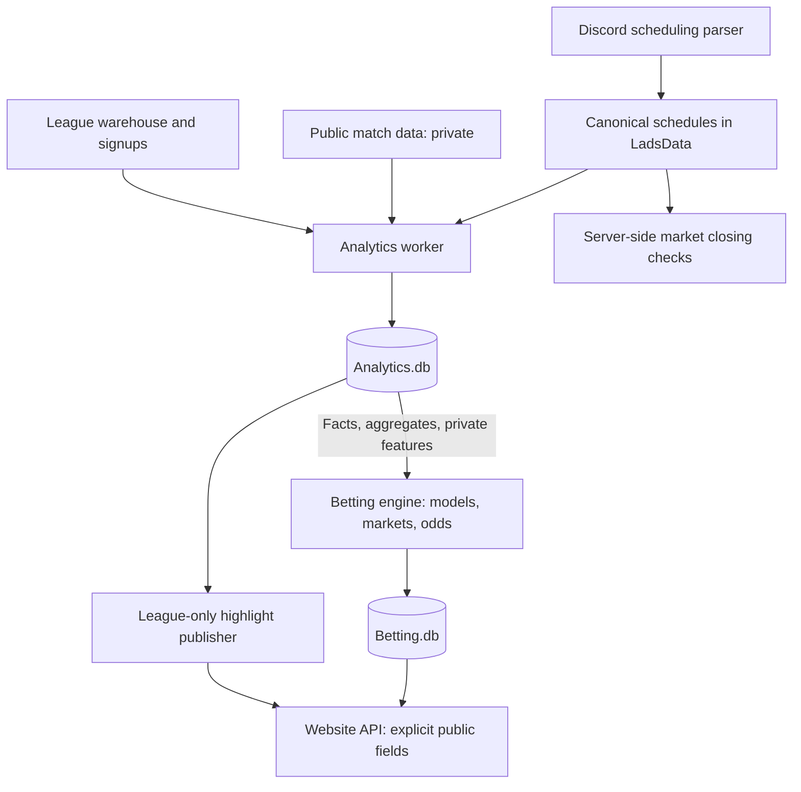

# Analytics and Betting Overhaul

Requirements and implementation plan · Decisions confirmed October 12, 2026.

Product decisions and initial operating defaults are confirmed. Schema details, model calibration, and integration work remain development tasks.

### Implementation status — October 14, 2026

The Analytics foundation is implemented: versioned SQLite schema, generation
builds/publication/retention, signup-era scope, stable team/roster identities,
validated league facts and stat summaries, private signup/public inputs, a
server-only Betting consumer, source freshness and availability instrumentation,
admin status, nightly/deploy integration, and backups. See
[analytics/README.md](analytics/README.md) for commands and limitations.

Automatic league highlights are also implemented: reproducible performance,
record/streak, hero trend, and champion templates; daily and weekly recaps;
durable fingerprints/publication revisions; persistent hide/edit/pause controls;
source correction/withdrawal handling; and a cached public homepage feed. Daily
recaps count toward the five daily story slots. Historical preview content is
admin-only, and its undated matches cannot generate dated recaps.

The homepage Content tab now presents a league-player catch-up feed: season
watch with group/playoff runs, published stage openings and verified reverse
sweeps, a player-moment notification table, and routine results tucked into a
collapsible section. Reverse-sweep publication requires known BO format and a
complete, timestamp-verified game sequence; legacy preview dates remain unknown.

The initial Betting release (phases 4–5) is implemented: canonical Discord/admin
fixtures, event-triggered refresh, private input/forecast provenance, validated
baseline pricing, BO2/BO3/BO5 markets and player props, preseason stats/leaders and
supported bracket futures, immutable tickets, season wallets, refunds, correction
ledgers, public sportsbook and admin controls. See [betting/README.md](betting/README.md)
for supported formats, validation gates, commands, and explicit actual-series
verification. Real production publication still requires eligible signup-era
history and verified sources; historical previews cannot price live bets.

The live sportsbook now shares the preview's expandable player tables and
alphabetical team/group layout, with real selectable quotes and a separate
player-leaders tab. BO2 group round-robin setup supports unequal group sizes.

Phase 6 now includes roster-strength and private public-feature candidates:
earlier rostered player records inform new lineups alongside signup MMR, while
current-season results enter the team's own record. Private daily observations
preserve actual feature availability. Each richer candidate must pass temporal
validation and match or improve the simpler reference on the same scored games
before automatic use. Insufficient history keeps the validated simpler model
or holds pricing. Elo remains excluded. Broader calibration, uncertainty work,
and deployment-host verification remain outstanding.

Tiebreakers are a separate stage: their games do not enter regular-season or
playoff betting statistics, pricing training, or new scheduled markets. Their
format varies by season; futures that require an unspecified tiebreaker path
remain held instead of assuming advancement rules.

An isolated Season 21 betting rehearsal is available with
`npm run betting:preview -- --league-id 19817 --match-rosters` and the protected
`/betting?previewLeague=19817` page. This user-authorized legacy testing exception
uses Season 20 performance only, reconstructs roster metadata from first complete
match lineups, and assumes saved group/rule setup. Conflicting players/insufficient
history are held; missing historical signup strength uses labeled neutral team
priors. Target results are read only after prices freeze, and mutation tests
verify target-season stats/results cannot change prices. It never changes live
publication gates, wallets, schedules, or Analytics scope. Exact historical
availability and roster membership remain unknown, so this is an illustration.

Completed signup-era builds can be limited with `--season-id`. Historical real
league data is available through `--preview-league` in an isolated preview file
and the admin Dataset selector. This testing exception keeps old roster
membership unknown and excludes previews from Betting; normal builds retain the
signup-era boundary.

## 1. Purpose and confirmed requirements

Create `Analytics.db` as a refined, reproducible view of the league warehouse. Update it daily, use it to identify entertaining overnight and weekly league stories, and supply relevant information to the betting engine. The betting engine calculates probabilities and odds and establishes markets in `Betting.db`.

| Area | Confirmed requirement |
| --- | --- |
| Private inputs | Public match data and Elo may inform betting judgements. Their underlying values and information must never appear on the frontend. |
| Public content | League facts, highlights, and published betting odds can appear on the website. |
| Publication | Odds and highlights publish automatically. |
| Ownership | Analytics supplies facts, aggregates, and private features. Betting owns market creation, probability modelling, odds formation, pricing, and settlement. |
| League history | Include signup-era seasons only. Earlier league seasons are outside the initial Analytics dataset. |
| Initial ratings scope | Leave Elo out initially. Private public-match information remains allowed; any Elo integration is a later optional extension. |
| Initial stat selection | Kills, deaths, assists, last hits, hero damage, tower damage, and healing for totals and per-game averages; GPM/XPM for averages only. Analytics retains all recorded stats. |
| Top-player markets | Add league-wide top kills, GPM, and XPM markets for the regular season. Ranking follows each market's metric: total markets rank totals; average markets rank per-game averages. Only rostered appearances count. Offer total-kills and average-kills leader markets; GPM/XPM leaders use averages. |
| Season-player market eligibility | At least 5 rostered regular-season games AND more than 50% of the player's team's official regular-season games. Applies to both total and average markets, including both types of player-leader selection. Bets on players who fail either requirement are void/refunded. |
| Preseason opening/closing | Open automatically after admins finalize rosters, groups, qualification rules, and regular-season game count. Close at the first scheduled regular-season kickoff, or earlier on a trusted actual-start signal. |
| Tied player leaders | Divide each winning selection's normal gross payout by the number of tied eligible winners. Compare the underlying metric before display rounding. |
| Odds movement | Combine analytical pricing with wager-driven movement bounded to ±10% of the current model-based decimal price. Accepted tickets retain their original odds. |
| Stake cap | Maximum cumulative 1,000 points staked per user per market. Repeated tickets share the cap. |
| Pricing margin | Keep the current configurable 10% reduction from fair decimal odds. This is a decimal-odds reduction, not a claim of exactly 10% overround. |
| Season balances | Each season starts with 10,000 site points per user. Preserve old tickets/results; unresolved older bets settle against their own season balance. |
| Scheduled player props | Whole-series props require participation in every official game; refund the player's series prop otherwise. A single-game prop requires participation in its specified game. |
| Scheduling exceptions | Keep tickets for the same rescheduled fixture. Refund series markets for cancellation/forfeit, or changed teams/BO format. Incomplete series wait for a verified final result. |
| Permanent roster changes | Refund affected unsettled preseason player selections after a genuine permanent replacement/transfer. Preserve historical team attribution; future scheduled props use the new effective roster. |
| Shortened/canceled seasons | Shortened: refund unsettled season-total markets; settle averages only for eligible players and team futures only from verified official outcomes. Canceled: refund all unresolved preseason markets. |
| Analytics operating defaults | Up to 5 daily highlights, including the previous day's recap, plus a Monday–Sunday weekly recap; last 10 eligible games for recent form; at least 5 valid samples for average comparisons. |
| Source freshness | At 48 hours without a successful required source refresh, warn and hold affected new prices. Public-input outages may use a validated league-only fallback. |
| Player/team scope | Players are expected to have one actual team in a season. Retain player + team + season keys; combined multi-team markets are unnecessary for the initial release. |
| Stand-in highlights | Include standout stand-in performances, clearly labeled. This does not change betting or roster-season eligibility. |
| Private public-match lookback | Use the recent 90 days relative to each input snapshot's as-of time, respecting source availability times. |
| Preseason players | Offer regular-season totals and averages. Exclude tiebreakers, playoffs, and stand-in appearances. |
| Preseason teams | Support champion futures; upper/lower bracket placement if practical. Elimination markets apply only when the format actually eliminates teams. |
| Regular-season series | BO2, including exact results 2–0, 1–1, and 0–2, plus player props. |
| Postseason series | BO3, with BO5 finals, plus player props. Store format per event rather than infer it from the stage alone. |
| Scheduling | Parse Discord posts containing two team identifiers, a numeric date or weekday, and flexible time formats. |
| Time shorthand | Missing AM/PM defaults to PM. Missing timezone, and colloquial EST, use `America/New_York`, including daylight saving time. Explicit AM/PM takes precedence. |

The existing use case has one current season at a time, although derived data should always be keyed by season/league so the architecture can support concurrent leagues later. All teams currently qualify for postseason; a generic “make playoffs” future would therefore be unhelpful.

## 2. Recommended boundaries

Keep SQLite for the first version. The project already uses it, and a daily worker with indexed summaries is a reasonable starting point for the current server. Do not introduce a separate database service solely for this feature.

| Database | Responsibility |
| --- | --- |
| `LadsData.db` | Operational authority: signups, roster history, team identity, groups, rules, schedules, matches, stages, and corrections. |
| `public.db` | Public match ingestion used privately for modelling. The signup-era cutoff applies to league seasons; public-match lookback is a separate feature policy. |
| `Analytics.db` | Validated league facts, aggregates, private features, highlight candidates, data quality, and dataset/content publication metadata. Derived facts can be rebuilt. |
| `Betting.db` | Betting model runs and input references, predicted outcomes, market definitions, odds and quote versions, accepted tickets, balances, transactions, settlement, and correction ledger. |

Analytics is a derived database, not another place for admins to edit match results or rosters. Changes originate in the operational data and flow through the next refresh. Accepted odds and financial records remain authoritative in Betting even if Analytics is rebuilt.

Application code performs calculations; the databases store their inputs and results. The Analytics worker prepares reusable information and highlights. A separate betting engine reads that information, applies betting models and pricing policies, and writes all market and odds records to `Betting.db`. Analytics does not select betting lines, produce market probabilities, apply margins, or establish odds.

### Frontend privacy boundary

- Public routes return explicitly selected fields. Never serialize an entire Analytics row or offer a database download.
- Public match statistics, Elo values, private feature vectors, model diagnostics, and raw source records stay private. This applies to admin interfaces, exports, errors, and generated highlight text too.
- Derived published prices are allowed. Explanatory copy must use league facts rather than disclose private inputs, such as a player's public-game performance or Elo.
- Signup screenshots remain admin-only in their existing storage. Analytics does not need image files or image payloads.
- Raw Discord messages and source metadata are operational parser records; the website needs the normalized fixture, not the original message content.

## 3. Current repository findings and prerequisites

These observations apply to the current `BettingOverhaul` branch.

| Existing area | Finding and required change |
| --- | --- |
| `nightlyRun.sh` | Exits early when no league is active. Analytics must also run during signup and between seasons. |
| `generatePublicMatchData.sh` | Public ingestion runs separately. Record its last successful snapshot instead of assuming it finished with league ingestion. |
| `ScheduledSeries` | Has a stable `UID`, team references, and a date, but lacks exact start time, explicit league/stage/format, and robust revision tracking. |
| `discordbot/discordbot.js` | Fetches only the latest ten messages, uses role names, parses only month/day, and ignores time. The current success path also exits with status 1. |
| `betting/initialize-odds.js` | Generates playoff matchup markets only. Uses win percentages and an arbitrary sweep split; the player-market function contains mock players and is disabled. |
| Current close time | Hardcoded to 22:00 UTC on the scheduled day, rather than the actual scheduled kickoff. |
| `betting/nightly-settlement-job.js` | Finds markets by team pair and identifies winners using option-name text. This cannot safely distinguish repeated fixtures or generalize to every market type. |
| `databaseBet.js` | Contains the balance/ticket machinery. Preserve accepted prices while separating model probabilities from any pool/exposure adjustments. |
| `config/leagueRules.js` | Upper/lower qualification uses configured slot counts and a tiebreaker position. Forecasts must reproduce these rules rather than assume a percentage cutoff. |
| `scripts/db/backupDatabases.sh` | Backs up LadsData, Betting, and public. Add Analytics when it is implemented. |

**Roster integration status:** the finalized roster/history work from `PreseasonChanges`, including commit `956ec43`, is now included on this branch after the merge from `origin/main` at `514bb3f`. Verify its effective membership rules when building Analytics; another branch merge is no longer a prerequisite.

Signup records already provide stable `TeamSubmissionId` identities before a Dota team ID is linked. Preserve that identity in Analytics and attach external team IDs as aliases. Do not make a Dota team ID mandatory for preseason prices or roster statistics.

Match dates and stage attribution also need validation. Historical `DatePlayed` values can be missing, and ingestion can use processing-relative dates. Preserve actual match start time separately from ingestion time; do not invent timestamps for historical records. Unknown stage/date records must not silently enter regular-season settlement or nightly/weekly content windows.

## 4. Proposed Analytics data model

Names below are proposed logical tables, not finalized migration SQL. Every derived record needs source lineage, an as-of time, and a dataset/feature-calculation version where applicable. Betting forecasts and quote records belong in `Betting.db`, outside this table list.

| Table family | Grain and purpose |
| --- | --- |
| `AnalyticsRuns`, `SourceSnapshots`, `AnalyticsState` | One build, one source watermark per build, and the currently published generation. Include status, versions, row counts, timings, and validation failures. |
| `Teams`, `TeamAliases`, `Players` | Stable internal identities, season/team submission linkage, external IDs, display names, and historical aliases. |
| `RosterMembership` | Player + team + effective interval + source roster revision. Membership at match time determines rostered/stand-in status. |
| `MatchFacts` | One validated match: league, stage, start time, duration, winner, source IDs, and validity/rehost policy. |
| `TeamGameFacts` | One team per match, with opponent, side, result, and team statistics. |
| `PlayerGameFacts` | One player per match/team: hero, recorded stats, result, and membership classification `rostered`, `stand_in`, or `unknown`. |
| `DraftEvents` | Match + pick/ban order, team side, and hero. |
| `SeriesFacts`, `ScheduleSnapshots` | Stable fixture/event identity, format, scheduled time, actual linked series, completed games, result, and schedule revision. |
| `TeamSeasonStats`, `PlayerTeamSeasonStats` | League + stage + team, or player + team. Store sums, valid sample counts, averages, and distributions. |
| `HeroStats`, `PeriodStats` | League hero trends and daily/weekly summaries. Keep regular-season and playoff scopes separate. |
| `PrivatePlayerFeatures`, `PrivateTeamFeatures` | Private public-match/league modelling features, availability times, sample sizes, and provenance. No Elo feature or rating snapshot is required initially. |
| `HighlightEvents`, `HighlightPublications` | Stable story fingerprint, league facts supporting the story, content window, publication state, and correction/suppression history. |

### Identity and eligibility rules

1. Partition by league and team identity, not team name. A renamed team is not a new team; identical names do not prove identity.
2. Signup rosters must survive later external team ID linking without changing their internal keys.
3. A player's stats for their own team and another team are separate records. Never combine stand-in performances into preseason roster totals or averages.
4. Use the effective roster at match time. A later roster edit must not retroactively classify every previous appearance as rostered.
5. Include only signup-era league seasons, using an explicit configured first included season or equivalent scope marker. Do not import older league seasons merely because they exist in the warehouse. Within included seasons, unresolved roster membership remains unknown; a lineup inferred from one game is not proof of season-long membership.
6. Deduplicate match/player/team joins. Conflicting team assignments, missing participants, invalid winners, and unmapped teams are validation failures, not extra games.
7. Missing values remain null with a valid-sample count. Zero is a measured zero, not a replacement for missing data.

Existing League Home spotlight eligibility remains a presentation rule: at least two appearances, at least 75% of a team's games through its first eight games, then more than 50%. The confirmed season-player betting threshold is at least 5 rostered appearances AND >50% of official team games. Neither threshold changes the other implicitly.

### Recorded statistics

The warehouse already has kills, deaths, assists, last hits, GPM, XPM, net worth, hero damage, tower damage, healing, heroes, results, and duration. These support useful season distributions and highlights without additional public ingestion.

For per-game averages, store the sum and exact valid game count and calculate the arithmetic mean of recorded per-game values. GPM/XPM averages are arithmetic means of game GPM/XPM, not duration-weighted rates. Total gold earned is a different statistic and is not established by summing GPM. A separately defined duration-weighted/per-minute feature may be useful privately but must not replace a market's declared measure.

Metric defaults are confirmed: count only official completed games; exclude abandoned/remade attempts superseded by an official replay; keep missing fields null. Use half-point count lines where practical and refund exact-line pushes. An unresolved required stat or official-game classification holds settlement until corrected rather than silently omitting a game, substituting zero, or guessing a result. Team participation denominators count actual official games played, not synthetic walkover scores.

## 5. Daily build and publication

Proposed flow:

1. Run operational league ingestion when a league is active. Continue to the Analytics workflow even when it is not.
2. Capture source snapshots/watermarks after successful ingestion. Record the public-data snapshot separately, including its freshness.
3. Start a separate Analytics worker process with a single-run lock. Use bounded queries/batches rather than loading the entire warehouse into JavaScript.
4. Validate identities, timestamps, stages, roster membership, completeness, and duplicate/conflicting facts.
5. Build curated facts and aggregates; snapshot private features with source availability times so Betting can select only information available at a forecast's as-of time.
6. Generate league highlights. Run data/content validation independently so a bad fixture does not prevent unrelated valid content from publishing.
7. Atomically publish the validated Analytics generation and eligible highlights. Notify downstream consumers that a new dataset is available; Analytics writes no markets or odds.
8. Run the separate betting engine against a fixed Analytics generation. Betting validates market readiness, runs forecasts/simulations, creates or updates markets, establishes odds, and publishes eligible quotes in `Betting.db`.
9. Run Betting settlement against validated actual outcomes, including older results that arrived late. Reconcile corrections separately.
10. Record each job's metrics, failure reasons, and backup status. Retain the previous Analytics generation if its build fails. A Betting pricing failure leaves Analytics and highlights available while affected markets follow Betting's freshness/suspension rules.

### Consistency and reruns

Use a stable `Analytics.db` file and generation IDs. Build a new generation, then switch `PublishedRunId` in a short transaction. Readers select one generation for the whole request. Initially retain the two latest usable summary generations; retain durable highlight publication history separately and avoid copying all historical facts for every run. Betting retains its forecast history and the input snapshots needed to explain accepted quotes.

SQLite WAL allows concurrent readers and a writer, but still permits only one writer at a time. Keep publication transactions short, manage checkpoints, and avoid replacing an open database file under active connections. Transactions spanning attached WAL databases are not atomic across all files; Betting records the consumed Analytics generation and uses unique market/run keys for idempotent processing. It can retry independently after dataset publication. [SQLite WAL documentation](https://www.sqlite.org/wal.html)

Read each source from a consistent snapshot and record its watermark. Independent source snapshots do not guarantee a simultaneous snapshot across databases. Use SQLite's backup API or `.backup` for live backups rather than copying a live `.db` file and overlooking its WAL. [SQLite backup documentation](https://www.sqlite.org/backup.html)

Rerunning an unchanged build must not duplicate highlights, create duplicate fixtures/markets, or settle a ticket twice. Corrections create a new version; accepted prices and historical prediction records remain intact.

### Refresh beyond the nightly job

Nightly refresh is sufficient for most historical aggregates. It is insufficient for kickoff changes, new fixtures, roster changes, or late match results.

- Trigger a small, debounced Analytics data refresh after schedule, roster, group, or league-stage changes, then notify Betting of the new inputs.
- Betting recalculates affected series markets and pending futures when inputs change. Betting suspends publication if their definition is no longer valid.
- Betting enforces kickoff locks on the server when accepting every bet. A browser countdown or nightly job is not the authority.
- Preserve a clear “as of” time for public content and Analytics inputs. Betting holds affected new prices when required inputs are stale.

The initial source freshness limit is 48 hours since the last successful source refresh/check, not since the last match was played and not simply since Analytics was rebuilt. Carry forward each source's true availability state. Warn on stale sources and hold affected new prices/acceptance against stale forecasts. If public-match inputs are unavailable or stale, Betting may use a separately validated league-only fallback with its own model/version; otherwise it holds the affected market. A missing private source does not block independently valid league highlights. Existing accepted tickets retain their original terms.

When a wager changes a quote, Betting must verify the current quote version, market status, wallet, and kickoff inside acceptance processing. An expired/stale quote is returned for review instead of silently accepting a different price.

## 6. Odds and market architecture

All forecasting, qualification/bracket simulations, line selection, margin application, odds formation, and market lifecycle logic in this section belong to the betting engine. Their definitions and results are stored in `Betting.db`.

### Analytics input contract

Betting reads a versioned, server-only Analytics interface containing:

- Stable player/team/event IDs, roster membership, league stage, qualification rules, and schedule/format snapshots.
- Observed results, stat totals, averages, distributions, valid sample counts, and historical context.
- Private public-match and league features with calculation versions, source availability times, and coverage/freshness indicators. Elo is excluded from the initial input contract.
- `AnalyticsRunId`, as-of timestamps, source watermarks, and quality flags.

These are reusable analytical inputs, not ready-made betting probabilities, recommended lines, or prices. Analytics reports source quality; Betting decides whether those inputs are sufficient to open or price a particular market.

Betting stores proposed `ForecastRuns` and `ForecastOutcomes` tables for model version, simulation seed, market scope, probabilities, uncertainty, and validation status. Each forecast also retains its Analytics generation reference and the exact consumed inputs or a durable input snapshot, so deleting an old Analytics generation does not lose pricing provenance. Private traces and consumed private features remain unavailable to frontend payloads.

Betting can change a pricing model or margin and reprice from the same Analytics generation without rebuilding Analytics. A new Analytics generation also does not automatically change accepted tickets; Betting determines which open markets need a new quote version.

### Market definitions

Store structured market definitions in `Betting.db`: `EventId`, `SeasonId`, `Stage`, `MarketType`, `StatKey`, `Scope`, `PlayerId`, `TeamKey`, `Line`, `Format`, `RulesVersion`, `ForecastVersion`, `AnalyticsRunId`, and `CloseAtUtc` as applicable.

Each quote has a version. Each accepted ticket stores its selection, line, odds, and settlement rules as accepted. Team names and option text are display fields, never settlement keys. Exact scores use two integers, not decimal encodings such as `2.1`.

| Format | Exact scores, expressed as Team A – Team B |
| --- | --- |
| BO2 | 2–0, 1–1, 0–2 |
| BO3 | 2–0, 2–1, 1–2, 0–2 |
| BO5 | 3–0, 3–1, 3–2, 0–3, 1–3, 2–3 |

An unfinished BO2 at 1–0 has no final score yet. Do not treat it as a completed series or void every missing result immediately. BO2 winner markets require a draw outcome or a clearly defined alternative; reusing two-outcome playoff moneylines would be incorrect.

### Modelling approach

Start with transparent baselines, then compare richer models against them on held-out signup-era seasons or chronological match windows when few seasons are available. Use included league history, roster strength, opponent context, and private public-match features when available. Elo is outside the initial implementation; adding it later would require a separately defined source/calculation and snapshot policy.

New teams need a roster-based prior rather than zero wins meaning zero strength. Sparse data should increase uncertainty and move estimates toward a defensible prior. Choose distributions for each statistic using observed league data; one normal or Poisson assumption does not fit every count, rate, or average.

As a simple sanity baseline, if independent games give Team A win probability `p`, BO2 exact-score probabilities are `p²`, `2p(1−p)`, and `(1−p)²`. BO3 and BO5 score probabilities should similarly arise from a coherent game/series model and sum to one. Independence is a baseline assumption to test, not a claim about actual Dota series.

Keep fair probabilities, configured margin, exposure adjustments, and displayed decimal odds separate. Backtest temporal calibration and error using only information available before each historical match; current ratings or later public matches must not leak into older forecasts.

### Pricing movement and season wallets

Confirmed: wagers influence offered odds alongside the betting model, but their influence must be scaled and bounded. Calculate each adjustment against the current analytical anchor, not recursively against the last adjusted price; repeated small bets must not compound into unbounded movement. Use the current cumulative exposure, soften sparse wager samples, and maintain coherent related outcome prices. Analytics neither reads wagering pools nor adjusts prices.

Keep the current 10% decimal-odds reduction configurable: the initial price policy is `fair decimal odds × 0.90`, with legal minimum price/rounding handled explicitly. Apply the pricing policy once after probability/exposure calculations, rather than repeatedly applying a new margin with every wager. The confirmed price-movement bounds are below; calibrate the smoothing algorithm within them during validation.

Confirmed initial bounds: every offered decimal price stays within ±10% of its current model-based anchor (after the margin, before wager movement). A 2.00 anchor therefore permits 1.80–2.20. Respect the bounds and minimum legal odds jointly; keep related probabilities/prices coherent and do not allow rounding to breach the bounds. New analytical inputs can establish a new anchor; wager activity alone cannot. The smoothing implementation can be tuned within these confirmed bounds.

Users may stake up to their available season-wallet balance, with no fixed per-ticket or cumulative per-market cap. Enforce wallet checks and debits atomically in Betting. Stakes must be positive whole centipoints and potential returns must fit exact point arithmetic. Multiple selections from the same market within one ticket remain prohibited.

Create season-scoped wallets/ledgers in Betting. Each user gets one 10,000-point starting credit per season, recorded idempotently. Earlier balances, tickets, results, and transactions remain historical; late payouts and refunds belong to the ticket's season and must not increase a new season's balance. Do not implement a reset by deleting old transactions or overwriting the sole existing balance. Preserve pre-overhaul tickets in an explicitly identified legacy season/account during migration.

Same-series outcomes and player props can be correlated. Initially restrict unsupported correlated parlays; multiplying their marginal odds does not make a valid joint price.

### Preseason player markets

- Cover regular-season games only, including both totals and averages.
- Initial statistics are kills, deaths, assists, last hits, hero damage, tower damage, and healing for totals and per-game averages, plus GPM/XPM averages. Do not offer sums of GPM/XPM as season totals.
- Include league-wide top-player markets for kills, GPM, and XPM. Ranking follows the metric specified by the market: total kills ranks total kills; average kills ranks average kills; GPM/XPM rankings use per-game averages. Include both total-kills and average-kills leader markets. All exclude stand-ins.
- Both season-total and season-average bets, including total/average leader selections, require at least 5 rostered regular-season appearances AND strictly more than 50% of the team's official regular-season games. Exactly 50% does not qualify. Void/refund selections on a player who fails either condition, including a player with no appearances. This is separate from League Home's early-season presentation threshold and does not impose a season-participation minimum on a scheduled-series prop.
- Include only rostered appearances for the market's defined team; exclude stand-ins.
- Confirmed operating assumption: one actual team per player in a season. Use player + signup team + season keys and do not implement combined multi-team markets initially. This does not itself change existing signup validation; conflicting memberships must be resolved rather than silently combined. A genuine permanent replacement or transfer voids/refunds affected unsettled preseason player selections. Keep historical membership effective intervals and use the new roster for future scheduled props. Distinguish real roster changes from ordinary source-data corrections.
- Forecast totals using projected eligible appearances and stat distributions. Forecast averages from the same eligible games with a published minimum-participation rule.
- Snapshot the roster and rules at market publication. No appearances or failing the 5-game/>50% threshold refunds the selection; permanent replacements/transfers refund affected unsettled preseason player selections. Shortened/canceled-season treatment is specified below.
- Leader ties use the exact underlying metric, not rounded display values. With `N` tied eligible leaders, a winning selection's gross payout is `stake × accepted decimal odds ÷ N`. For example, a 100-point stake at 4.0 returns 200 points when two players tie. This splits gross returns, not only profits. Ineligible selections are void/refunded before determining eligible leaders.

### Preseason team futures

Upper/lower placement is practical when groups and qualification rules are finalized. Simulate remaining regular-season games, derive standings using the league's actual ranking/tiebreaker logic, and assign configured slots. A team's probability is its frequency of reaching that bucket across simulations, not the raw percentage of available places.

Then simulate the actual playoff bracket and BO3/BO5 formats for champion, finalist, or round-of-elimination futures. Offer only outcomes supported by that season's format. “Eliminated before playoffs” and “eliminated in a playoff round” are distinct markets.

Confirmed preseason readiness point: admins finalize rosters, groups, qualification rules, and the regular-season game count. This should be an explicit finalized setup revision, not inferred from a signup closing date or from groups merely having some teams assigned. Betting opens eligible preseason markets automatically after that revision is finalized and closes them at the first scheduled regular-season kickoff, or earlier if a trusted actual-start signal arrives. A verified first kickoff is required to establish the closing deadline; missing scheduling information keeps publication pending.

### Scheduled player props and settlement

Props need explicit scope: one game, the whole series total, or a per-played-game average. BO3/BO5 series totals vary with the number of games actually played, which the forecast must model.

Confirmed participation policy: a whole-series player prop requires that player to appear in every official game of that completed series. Refund that selection if they miss any game, including no appearances. A single-game prop requires participation in the specified game. Do not apply the preseason 5-game/>50% threshold to these scheduled props.

Use explicit scheduled-event-to-actual-series links. Matching team names or a team pair/date is a candidate lookup, not a sufficient settlement identity. Repeated fixtures must remain distinct.

Confirmed scheduling exception policy:

- Preserve accepted tickets when the same fixture is rescheduled, updating its verified start/close times and schedule revision. Preserve kickoff safeguards; an already started event cannot reopen merely because its date changed.
- Void/refund affected series markets for a cancellation or forfeit. Do not fabricate player statistics or a played series score from a walkover.
- If either team or the BO format changes, void/refund the old fixture's markets and create a new definition if eligible.
- Hold incomplete series until a verified final result or an explicit cancellation/forfeit classification; missing data alone is not proof of cancellation.

### Shortened and canceled seasons

Confirmed policy:

- If the official regular-season game count is reduced after preseason publication, void/refund unsettled season-total markets, including total-leader markets. A postponement alone does not shorten the season.
- Settle season-average markets and average-leader selections only where the player meets both the 5-game and >50% requirements using actual official regular-season games played. Refund ineligible selections.
- Settle team futures only where the official competition has verified the exact offered outcome; refund unresolved futures when the season ends without establishing it. Do not infer an upper-bracket qualification or champion solely from unfinished standings.
- A canceled season refunds all unresolved preseason markets. Preserve already settled records; a later correction uses the existing traceable adjustment path.
- Store the season's completion classification explicitly. A match ingestion failure is not evidence that a season was shortened or canceled.

The confirmed official-game, remake, and push defaults are in the metric definitions above. Missing or conflicting official-game status holds settlement instead of guessing.

Settlement and any balance correction must be idempotent inside Betting's transaction/ledger. A late data correction generates a traceable adjustment, not deletion of the original ticket or transaction. Forecasts never serve as actual results.

## 7. Discord scheduling improvements

Confirmed examples are two team identifiers followed by a date/time, including `9pm est`, `9est`, `9 pm`, `9 est`, numeric dates, and weekday names. Exact historic posts are unavailable, so the following are parser acceptance examples rather than verbatim messages.

| Example suffix | Expected interpretation |
| --- | --- |
| `Saturday 9pm est` | Saturday at 21:00 New York local time. |
| `Saturday 9est` | Same interpretation; PM is assumed. |
| `10/17 9 pm` | October 17 at 21:00 New York local time, with inferred year recorded. |
| `10/17 9 est` | Same interpretation, including daylight saving time. |
| `2026-10-17 9 AM` | October 17, 2026 at 09:00 New York local time. |

Store the original timezone and canonical UTC instant. “EST” is deliberately treated as the league's colloquial New York timezone, not fixed UTC−5. Explicit supported timezone names or numeric offsets can override the default.

Proposed parser requirements:

1. Resolve two teams using Discord role IDs or explicit external team IDs mapped to stable season teams. Discord role IDs and Dota team IDs are different identifiers. Team names alone require an unambiguous alias match.
2. Support spacing variations, AM/PM, 24-hour times, `M/D`, `M/D/YYYY`, ISO dates, and weekday names. Proposed numeric-date convention is US month/day.
3. Resolve relative dates against the message's authored/edited timestamp in the league timezone, never the day an old post happens to be imported. A weekday means the next occurrence with a future scheduled time; handle same-day posts explicitly.
4. Infer a year only within a defined scheduling horizon, including December/January rollover. Conflicting dates, multiple possible fixtures, ambiguous DST times, and unrecognized teams enter a resolution queue instead of opening markets.
5. Persist channel/message ID, revision, parser version, normalized values, assumptions, and parse status. An edit updates the fixture revision instead of creating a duplicate.
6. Support reschedules and cancellation/deletion handling. Deleting a message should suspend affected betting until its meaning is established, not silently erase an accepted event.
7. Use incremental ingestion with a persisted cursor and catch-up history. If a continuously connected bot would be too heavy on the current host, polling must still process all unseen messages and reconcile relevant edits.
8. Provide an admin schedule correction path. A confident parse can publish automatically; a conflicting parse stays pending until resolved. Automatic Discord clarification messages are an optional later feature.

Canonical schedule fields should include `EventId`, season/league, both stable team keys, stage, format, `ScheduledStartUtc`, `Timezone`, status, revision, source message, and actual series linkage.

Confirmed closing policy: lock at scheduled kickoff, or earlier when a trusted live-start signal arrives. Reschedules must not reopen an already started match. Changing teams or format refunds the old fixture's markets; a same-fixture reschedule preserves accepted tickets and updates its verified deadline.

## 8. Highlight generation

Start with rule-based templates over validated league facts. This makes content reproducible and allows automatic publishing without requiring a language model.

Useful first categories:

- Overnight standout games across farming, damage, healing, siege, and survivability as well as kills/assists.
- Season or signup-era bests, with the comparison period and minimum sample clearly identified. Do not claim an all-time career record when pre-signup league history is excluded.
- Team winning streaks and a streak ending.
- Hero variety, draft popularity, and emerging league trends.
- Weekly leaders, close races, and notable movement in regular-season standings.
- Daily recaps of completed New York calendar days, published on the next successful build.
- Champion-run summaries comparing group and playoff performances.

Do not promise gold-lead comebacks or objective timelines until those inputs are actually ingested. Final net worth and final result alone do not establish a comeback.

Each candidate records its supporting match IDs, statistic, comparison scope, cutoff, and a stable fingerprint. Rank and limit stories so a single player or team does not fill the homepage.

Confirmed configurable defaults:

- Publish up to 5 daily highlights across all refreshes of a local calendar day, plus a weekly recap. Do not manufacture stories to fill the quota.
- Weekly windows are Monday–Sunday in `America/New_York`; publish the completed week's recap on the subsequent successful build. Label partial-week views.
- Recent form uses the last 10 eligible games within the declared season/stage/team scope. An early sample can contain fewer games and must show its count.
- Average-based comparisons require at least 5 valid samples. This does not prohibit a verified single-game achievement or change the existing League Home spotlight rules.
- Publish each story fingerprint once. Source corrections revise or withdraw that publication instead of creating a duplicate; weekly recap inclusion is a separate, labeled summary.

Distinguish games played overnight from older games newly ingested overnight. Weekly windows use the league timezone. Stand-in single-game achievements are included and clearly labeled, but must not be presented as roster-season records or counted toward preseason/top-player market results.

Publish automatically after validation. Admins can hide, correct, or pause publication, with those overrides surviving regeneration. If a supporting match is corrected or invalidated, revise or withdraw the affected story rather than leave stale claims public.

## 9. Operations and performance

For the current 1 GB server, start with one worker and measure peak resident memory, runtime, query latency, WAL growth, disk space, and API latency during a build. RAM alone cannot establish the number of simultaneous players the API can serve.

- Build aggregates in SQL and stream/batch any application processing. Avoid loading all public matches or all league facts into memory at once.
- Keep heavy modelling and ingestion in a separate process so synchronous SQLite work does not block the API event loop.
- Use indexes for league/stage/date, team, player, roster intervals, event IDs, and publication keys based on actual query plans.
- Serve a small, paginated/cached highlight feed. The homepage should not trigger a warehouse scan or load model inputs.
- Retain stable facts and compact summaries; bound intermediate generations and scratch files.
- Register schema migrations, backup/restore, first-build and replay commands, plus an admin-visible job status showing safe operational metrics rather than private features.
- Keep source backups even though facts are rebuildable. Betting forecast/input snapshots and Analytics content history cannot necessarily be reconstructed from today's mutable source data.

## 10. Delivery phases

| Phase | Deliverable |
| --- | --- |
| 1. Foundation | Verify the merged roster/history integration; settle identities and source quality; create Analytics migrations, build metadata, snapshots, and publication generations. |
| 2. Curated data | Implement validated match/player/team facts, regular/playoff scopes, aggregates, and private public-match/league feature snapshots. Backfill only signup-era league seasons, with explicit unknowns. |
| 3. Highlights | Ship league-only templates, automatic publication, deduplication, correction handling, and a compact public API. |
| 4. Schedules and series betting | Upgrade Discord parsing and canonical events; implement the Betting-owned input consumer, forecast storage, markets/odds, typed BO2/BO3/BO5 outcomes, exact kickoff locking, structured settlement, and scheduled props. |
| 5. Preseason betting | Finalize launch/eligibility rules; Betting adds regular-season totals/averages markets, qualification simulation, and champion futures using Analytics inputs. |
| 6. Model improvement | Improve Betting's models using the private public-match/league features supplied by Analytics; evaluate temporal calibration, uncertainty, and richer joint simulation against recorded baselines. Elo is a possible later extension, not an initial dependency. |

Automatic publication does not require publishing an unvalidated model. Validate the initial model and settlement rules before enabling markets; subsequent eligible outputs publish automatically.

### Implementation acceptance checks

- An identical rerun creates no duplicate stories, fixtures, markets, or wallet credits.
- A failed build leaves the last complete publication available; a request never mixes generations.
- Analytics creates no market, line, betting forecast probability, or odds records. Betting owns those calculations and stores their results.
- Betting can rerun pricing from a fixed Analytics generation; accepted quotes remain unchanged and retain durable input provenance.
- Repeated wagers cannot move prices beyond the configured analytical-anchor bounds or repeatedly apply the margin. Repeated tickets remain limited by the available season-wallet balance.
- Offered prices respect the ±10% anchor bounds; repeated/alternative-selection/parlay wagers debit the wallet atomically under concurrent requests.
- Season starting credits occur once, and an old ticket's late payout/refund cannot alter a new season wallet.
- External team ID linking preserves roster and forecast identity.
- Stand-in games cannot enter preseason roster totals/averages; unknown membership is surfaced for resolution.
- Both total and average season-player markets enforce the 5-game minimum and strictly >50% team-game participation, refunding ineligible selections. Total/average leader rankings use their declared metric; tied eligible winners receive divided gross payouts.
- Preseason markets open only after the finalized setup revision and a verified closing deadline exist, then lock at the first regular-season kickoff or earlier verified actual start.
- League facts, comparisons, and modelling inputs exclude pre-signup seasons. Record claims explicitly reflect signup-era coverage.
- The initial pipeline does not require, calculate, or consume Elo.
- Public/API/admin/export/error payloads contain no private public-match or Elo features.
- Series score probabilities sum to one and contain only legal results for the event format.
- Incomplete or unmatched results remain unresolved; settlement uses typed keys, not team-name text.
- A player missing any official series game gets their whole-series prop refunded. Same-fixture reschedules preserve tickets; canceled/forfeited or changed-team/format fixtures refund affected series markets.
- Permanent roster changes refund affected preseason player selections without rewriting historical team stats. Shortened seasons refund unsettled total markets; canceled seasons refund unresolved preseason markets.
- Source age survives rebuilds; stale public inputs use only a validated fallback, and stale required inputs cannot create or accept new quotes.
- Daily refresh reruns respect the 5-story cap; weekly/recent-form comparisons use the configured timezone, sample counts, and 10-game window.
- Schedule tests cover shorthand, explicit AM, DST, weekday resolution, year rollover, edits, duplicates, and cancellations.
- Server-side close checks reject bets after kickoff even if the browser is stale.
- Corrections preserve accepted quotes and produce traceable, idempotent settlement adjustments.
- A build stays within measured resource budgets and leaves ordinary website requests responsive.

## 11. Confirmed Analytics defaults

Analytics prepares information and highlights; Betting owns market forecasts and prices. The following scope and defaults are confirmed and should remain configurable where appropriate.

| Topic | Confirmed scope / initial default |
| --- | --- |
| Historical coverage | Confirmed: signup-era league seasons only. Configure an explicit first included season/scope marker and apply it to facts, summaries, comparisons, and Betting inputs. Older operational warehouse data remains outside Analytics. |
| Private Elo source | Confirmed: leave Elo out initially. No rating source/calculation is needed for the first release. A future rating would be a private feature; converting it into matchup probabilities would remain Betting's responsibility. |
| Private public-match lookback | Confirmed: recent 90 days, relative to the snapshot/forecast as-of time. Do not include later games in historical feature snapshots. Keep valid sample counts and coverage indicators. |
| Statistic definitions | Versioned metric catalog with per-game arithmetic averages, exact valid denominators, stage/membership scope, null handling, and official-game/replay policy. Exclude superseded remakes; refund exact-line pushes. |
| Comparison windows | Season and signup-era summaries; last 10 eligible games for recent form; Monday–Sunday weekly windows in New York time. Label partial windows and newly imported historical games. |
| Source freshness and partial failures | 48-hour freshness limit per source. Warn and hold affected new pricing when stale; allow only a validated league-only fallback when public inputs fail. League highlights remain independent of private-source outages. |
| Highlight significance | Include clearly labeled stand-in achievements. Up to 5 daily stories plus a weekly recap; at least 5 valid samples for average comparisons. Deduplicate stable story fingerprints and update corrected publications. |
| Corrections and retention | Rebuild affected summaries and retract/revise affected content after source corrections. Keep historical source/feature availability times for reproducible as-of queries. Bound scratch generations while preserving published content history; Betting separately retains consumed pricing inputs. |
| Operational visibility | Add safe job status: last successful run, source freshness, unresolved identity/roster counts, rejected fact counts, runtime, and publication state. Admins can retry a build or resolve source records without displaying private feature values. |

Implement the metric catalog, explicit season cutoff, data quality status, and reproducible correction handling in the foundation. Use the confirmed defaults for the initial release and expose safe configuration without exposing private features.

## 12. Development details to resolve during implementation

No product questions from the decision rounds remain open. The following are implementation and validation tasks, not requests for another approval round:

1. **Source integration:** identify the first signup-era season, map warehouse fields and authoritative official-game classifications, and connect effective roster history. Never guess unresolved identities or stage boundaries.
2. **Schema and migrations:** finalize table names/indexes, generation retention, source watermarks, event revisions, finalized setup state, and explicit season completion classifications.
3. **Betting validation:** calibrate priors, distributions, sample/coverage quality gates, simulation size, and wager smoothing inside confirmed price/stake bounds. Validate the league-only fallback before using it automatically.
4. **Accounting migration:** preserve legacy bets and balances, introduce season wallets and idempotent starting credits, and define precise point rounding for divided payouts and refunds.
5. **Quote and outcome processing:** implement concurrent cap/wallet/quote checks, safe repricing, typed settlement, voided-leg/parlay handling, official-result linkage, and traceable corrections. Initially exclude unsupported correlated combinations.
6. **Operations and UI:** register nightly and event-triggered jobs, complete Discord catch-up/revision handling, add safe job status, build the public highlight feed, and verify memory/query budgets on the deployment host.

Remaining launch work: collect sufficient timestamped signup-era validation
history, verify actual Discord ingestion and nightly/deploy jobs, and run the
read-only HTTP benchmark on the deployment host alongside server RAM/CPU
monitoring. The isolated end-to-end betting tests cover publication, wagers,
verified results, settlement corrections, and season-wallet isolation. These
tests do not establish production calibration or a maximum player capacity.

Operational hardening is implemented and locally tested: persistent refresh
attempt/failure/retry state, bounded automatic backoff and restart recovery,
per-channel Discord polling leases and tracked edit/deletion reconciliation,
explicit tiebreaker-stage parsing, and derived-data refresh after partial league
or public-source ingestion. Deployment backs up before initialization/migrations
and publishes the client only after derived workers succeed. No staging URL is
available; this does not replace real Discord/cron/deployment-host verification.
